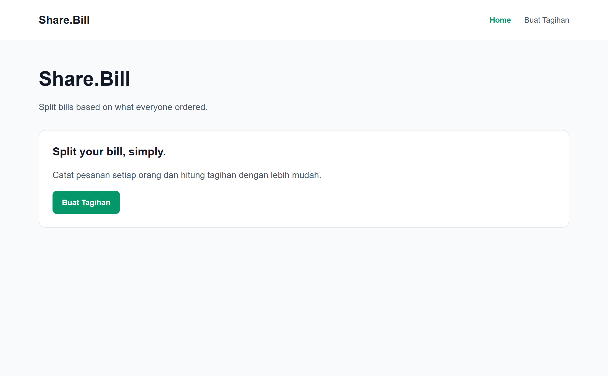
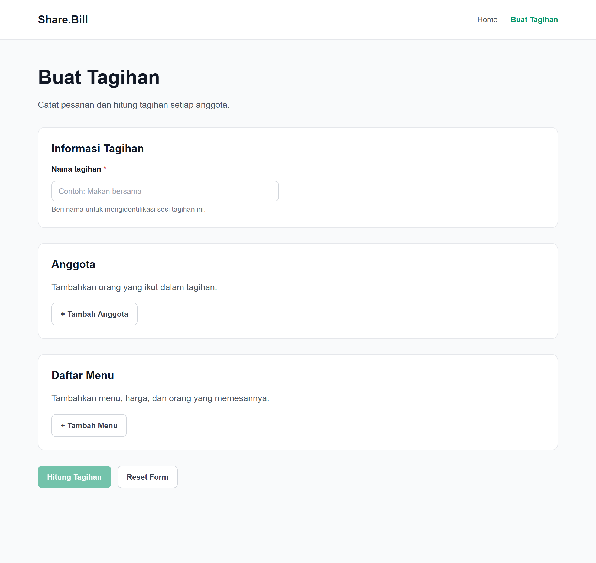
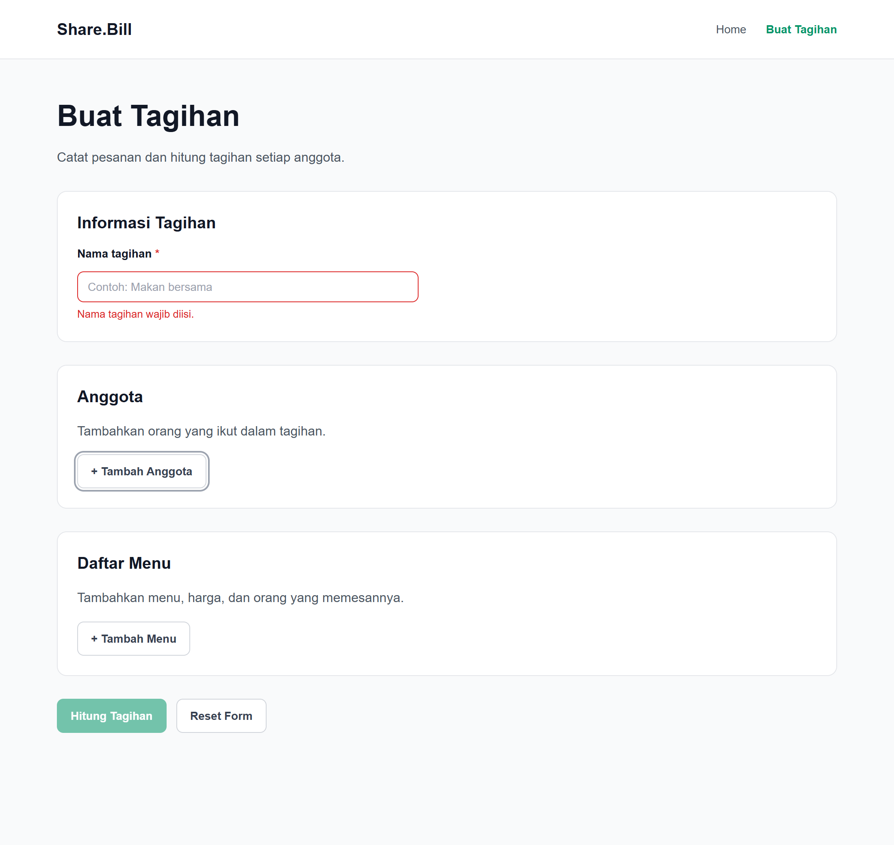

# Laporan Praktikum AP1 Tugas 5b — Component Library
## Proyek: Share.Bill

---

### Informasi Proyek & Identitas Kelompok

- **Mata Kuliah:** Application Project 1 (AP1)
- **Kelompok:** QWERTY
- **Nama Proyek:** Share.Bill
- **Jenis Aplikasi:** Aplikasi pembagian tagihan berdasarkan pesanan masing-masing orang
- **Tautan Repository GitHub:** [https://github.com/Jibril061/Share.Bill](https://github.com/Jibril061/Share.Bill)
- **Anggota Kelompok:**
  1. Mukhamad Jibril Hidayatullah
  2. Daffa Muhamad Ramadhan
  3. Marchel Yohannes Sihombing

---

## 1. Tujuan Pembuatan Component Library

Pengembangan *Component Library* pada proyek Share.Bill bertujuan untuk:
1. **Meningkatkan Konsistensi Antarmuka (UI Consistency):** Menghindari inkonsistensi styling seperti perbedaan warna tombol, ukuran border-radius, ketebalan font, dan padding antarelemen.
2. **Efisiensi Pengembangan (Reusability & DRY):** Memungkinkan pengembang menggunakan kembali komponen antarmuka yang sudah teruji tanpa menulis ulang kode HTML/CSS dari awal (*Don't Repeat Yourself*).
3. **Mempermudah Pemeliharaan Kode (Maintainability):** Perubahan desain atau penyesuaian styling dapat dilakukan secara terpusat pada file komponen dan stylesheet terkait, tanpa harus mengubah puluhan file halaman.
4. **Mendukung Standar Aksesibilitas (Accessibility & WAI-ARIA):** Mengemas logika aksesibilitas seperti label, deskripsi bantuan, penanganan galat (*error alert*), dan status keyboard focus langsung ke dalam komponen reusable.

---

## 2. Gambaran Singkat Share.Bill

**Share.Bill** adalah aplikasi web berbasis *Single Page Application* (SPA) yang dirancang untuk mempermudah kelompok atau perorangan dalam membagi tagihan pembayaran (misalnya makan bersama di restoran) secara adil berdasarkan rincian pesanan setiap anggota.

Aplikasi dibangun menggunakan stack teknologi modern:
- **React 19** untuk rendering antarmuka reaktif.
- **TypeScript** untuk keamanan tipe data dan pencegahan bug runtime.
- **Vite 8** sebagai build tool dan development server berkecepatan tinggi.
- **React Router 8** untuk navigasi client-side tanpa reload halaman.
- **CSS Modular** untuk fleksibilitas kontrol desain tanpa dependensi framework CSS yang berat.

---

## 3. Prinsip Desain dan Konsistensi Style Guide

### Status Penelusuran Style Guide Pertemuan 3
Berdasarkan pemeriksaan langsung terhadap seluruh berkas di repositori proyek, **dokumen style guide formal Pertemuan 3 tidak ditemukan secara terpisah dalam berkas repositori**. Oleh karena itu, kepatuhan mutlak terhadap dokumen acuan tersebut **belum dapat diverifikasi secara tertulis dari sumber dokumen asli**.

### Analisis Desain Berdasarkan Bukti Aktual Repositori
Meskipun dokumen acuan Pertemuan 3 tidak tersedia di repositori, seluruh komponen reusable yang dibangun dirancang dengan mengacu secara ketat pada sistem desain dan token visual yang telah terbentuk pada kode sumber sebelumnya (`src/App.css` dan `src/index.css`), yang mencakup:

1. **Palet Warna (Color Palette):**
   - **Primary Brand:** `#059669` (Emerald Green) — Digunakan pada tombol utama, border aktif, dan aksen navigasi.
   - **Primary Hover:** `#047857` (Dark Emerald Green) — Digunakan pada transisi hover aksi utama.
   - **Neutral Dark (Text/Heading):** `#121826` — Warna teks utama dengan kontras tinggi.
   - **Neutral Muted (Body/Helper):** `#4b5563` dan `#6b7280` — Warna teks penjelas dan teks bantuan.
   - **Neutral Border:** `#e5e7eb` (garis kartu) dan `#d1d5db` (garis input/tombol sekunder).
   - **Background:** `#f9fafb` (latar aplikasi) dan `#ffffff` (latar komponen kartu dan input).
   - **Status Error:** `#dc2626` — Warna indikator galat form dan teks peringatan.

2. **Tipografi (Typography):**
   - Font family: `Arial, Helvetica, sans-serif`.
   - Skala teks: Judul kartu (`20px`, font-weight 600, line-height 28px), teks input dan tombol (`14px`, line-height 20px), teks bantuan/error (`13px`, line-height 1.4).

3. **Bentuk dan Radius (Border Radius):**
   - Kontainer besar (*Card*): `border-radius: 12px`.
   - Elemen interaktif (*Button*, *Input*): `border-radius: 8px`.

4. **Spasi dan Tata Letak (Spacing & Layout):**
   - Margin kartu: `28px` (desktop) dan `20px` (mobile).
   - Padding kartu: `24px` (desktop) dan `18px` (mobile).
   - Gap vertikal form: `6px` antara label, input, dan teks bantu/error.

---

## 4. Dokumentasi Komponen

### A. Komponen Button (`src/components/Button.tsx`)

Komponen tombol interaktif serbaguna yang memperluas atribut native `<button>` HTML dan mendukung variasi visual serta status nonaktif.

#### Tabel Properti (Props)

| Nama Prop | Tipe Data | Status | Default | Deskripsi Fungsi |
| :--- | :--- | :---: | :---: | :--- |
| `variant` | `'primary' \| 'secondary'` | Opsional | `'primary'` | Menentukan gaya visual tombol (warna utama atau warna sekunder). |
| `size` | `'sm' \| 'md' \| 'lg'` | Opsional | `'md'` | Menentukan dimensi ukuran dan padding tombol. |
| `fullWidth` | `boolean` | Opsional | `false` | Menjadikan lebar tombol 100% dari kontainer induknya. |
| `disabled` | `boolean` | Opsional | `false` | Menonaktifkan interaksi tombol dan menerapkan `aria-disabled="true"`. |
| `type` | `'button' \| 'submit' \| 'reset'` | Opsional | `'button'` | Menentukan tipe perilaku native HTML button. |
| `className` | `string` | Opsional | `''` | Menambahkan kelas CSS tambahan jika diperlukan kustomisasi khusus. |
| `children` | `React.ReactNode` | **Wajib** | - | Konten teks, ikon, atau elemen di dalam tombol. |
| `...rest` | `React.ButtonHTMLAttributes` | Opsional | - | Mendukung seluruh atribut standar HTML (misal `onClick`, `id`, `title`). |

#### Variasi Visual (Variants)
- **Primary (`btn-primary`):** Latar belakang hijau emerald `#059669` dengan teks putih `#ffffff`. Digunakan untuk aksi utama (Call to Action / CTA) seperti *"Buat Tagihan"*.
- **Secondary (`btn-secondary`):** Latar belakang putih `#ffffff` dengan bingkai `#d1d5db` dan teks abu-abu gelap `#374151`. Digunakan untuk aksi pendukung seperti *"+ Tambah Anggota"* dan *"Reset Form"*.
- **Ukuran (`sm`, `md`, `lg`):** Pilihan padding mulai dari `6px 12px` hingga `12px 20px`.

#### State yang Didukung
- **Hover:** Transisi warna latar belakang lebih pekat (`#047857` untuk primary, `#f3f4f6` untuk secondary).
- **Focus-Visible:** Outline cincin fokus 2px dengan offset 2px untuk navigasi keyboard aksesibel.
- **Disabled:** Opasitas 0.55, pointer events dinonaktifkan (`pointer-events: none`), kursor `not-allowed`, dan atribut `aria-disabled="true"`.

#### Contoh Pemakaian Nyata di Share.Bill

```tsx
import Button from '../components/Button'

// 1. Tombol Aksi Utama
<Button variant="primary" type="button">
  Buat Tagihan
</Button>

// 2. Tombol Aksi Sekunder
<Button variant="secondary" type="button" onClick={handleAddMember}>
  + Tambah Anggota
</Button>

// 3. Tombol State Disabled
<Button variant="primary" disabled title="Lengkapi data terlebih dahulu">
  Hitung Tagihan
</Button>
```

#### Batasan Komponen
- Belum memiliki varian status *loading* dengan animasi spinner bawaan saat menunggu proses asynchronous.

---

### B. Komponen Card (`src/components/Card.tsx`)

Komponen pembungkus konten modular berdesain kartu semantik yang menyatukan header, judul, deskripsi, dan isi konten.

#### Tabel Properti (Props)

| Nama Prop | Tipe Data | Status | Default | Deskripsi Fungsi |
| :--- | :--- | :---: | :---: | :--- |
| `title` | `React.ReactNode` | Opsional | `undefined` | Judul kartu. Jika berupa string, otomatis dibungkus tag `<h2>` konsisten. |
| `subtitle` | `React.ReactNode` | Opsional | `undefined` | Teks keterangan atau subjudul di bawah judul utama. |
| `headerAction` | `React.ReactNode` | Opsional | `undefined` | Slot elemen aksi di sisi kanan atas header kartu (misal tombol hapus). |
| `as` | `'section' \| 'article' \| 'div'` | Opsional | `'section'` | Elemen semantik HTML yang digunakan sebagai kontainer utama. |
| `className` | `string` | Opsional | `''` | Kelas CSS tambahan untuk kebutuhan tata letak khusus. |
| `children` | `React.ReactNode` | **Wajib** | - | Elemen isi atau tubuh konten kartu (*card body*). |

#### Variasi Penggunaan
- **Card dengan Judul:** Menampilkan header dengan judul tebal (`h2.card-title`).
- **Card dengan Judul & Subtitle:** Menampilkan header dengan teks keterangan pendukung.
- **Card Konten Polos:** Merender kontainer berbingkai tanpa header saat `title` dan `subtitle` tidak disertakan.

#### State yang Didukung
- **Responsive Box:** Otomatis menyesuaikan padding dari `24px` di desktop menjadi `18px` pada layar sempit/ponsel.

#### Contoh Pemakaian Nyata di Share.Bill

```tsx
import Card from '../components/Card'
import Button from '../components/Button'

<Card title="Anggota" subtitle="Daftar peserta yang terlibat dalam pesanan">
  <p>Tambahkan orang yang ikut dalam tagihan.</p>
  <Button variant="secondary" type="button">
    + Tambah Anggota
  </Button>
</Card>
```

#### Batasan Komponen
- Belum memiliki slot sub-komponen terpisah seperti `<Card.Footer>` terstruktur, melainkan seluruh elemen bawah disusun langsung di dalam `children`.

---

### C. Komponen FormField (`src/components/FormField.tsx`)

Komponen formulir input yang mengutamakan kepatuhan aksesibilitas web (WAI-ARIA). Komponen ini secara otomatis mengelola relasi label, input, teks bantuan (*helper text*), dan pesan galat (*error alert*).

#### Tabel Properti (Props)

| Nama Prop | Tipe Data | Status | Default | Deskripsi Fungsi |
| :--- | :--- | :---: | :---: | :--- |
| `label` | `string` | **Wajib** | - | Teks label yang terhubung langsung ke input via atribut `htmlFor`. |
| `id` | `string` | Opsional | `useId()` | ID unik elemen input. Jika tidak diisi, otomatis digenerate via React `useId()`. |
| `helperText` | `string` | Opsional | `undefined` | Teks informasi panduan di bawah input, terhubung via `aria-describedby`. |
| `error` | `string` | Opsional | `undefined` | Pesan galat validasi dengan `role="alert"`. Memicu styling bingkai merah. |
| `required` | `boolean` | Opsional | `false` | Menampilkan tanda bintang merah `*` dan atribut HTML `required`. |
| `disabled` | `boolean` | Opsional | `false` | Menonaktifkan input dan mengubah tampilan latar menjadi abu-abu terang. |
| `labelSuffix` | `React.ReactNode` | Opsional | `undefined` | Slot elemen tambahan di samping kanan label (misal badge atau tautan bantuan). |
| `containerClassName` | `string` | Opsional | `''` | Kelas CSS tambahan pada wrapper induk form field. |
| `...inputProps` | `React.InputHTMLAttributes` | Opsional | - | Mendukung seluruh atribut native `<input>` (`value`, `onChange`, `onBlur`, dll.). |

#### Fitur Aksesibilitas (WAI-ARIA)
- **Keterhubungan Label:** Elemen `<label>` terhubung ke input dengan atribut `htmlFor={id}`.
- **Status Galat:** Ketika properti `error` bernilai teks, input otomatis mendapatkan atribut `aria-invalid="true"` dan pesan kesalahan dirender dengan `role="alert"`.
- **Deskripsi Otomatis:** Atribut `aria-describedby` secara dinamis menghubungkan input ke ID pesan error (`{id}-error`) atau ID helper text (`{id}-helper`).
- **Dukungan ForwardRef:** Dibungkus dengan `React.forwardRef` untuk kompatibilitas integrasi dengan library form atau manipulasi fokus DOM.

#### State yang Didukung
- **Default (Idle):** Bingkai abu-abu `#d1d5db` dengan latar putih.
- **Focus:** Highlight cincin warna hijau emerald `#059669` dengan efek bayangan fokus (`box-shadow: 0 0 0 3px rgba(5, 150, 105, 0.15)`).
- **Error:** Bingkai merah tegas `#dc2626` dan teks pesan kesalahan merah di bawah input.
- **Disabled:** Latar belakang `#f3f4f6`, teks pudar, kursor `not-allowed`.

#### Contoh Pemakaian Nyata di Share.Bill

```tsx
import { useState } from 'react'
import FormField from '../components/FormField'

function ExampleForm() {
  const [billName, setBillName] = useState('')
  const [touched, setTouched] = useState(false)
  const hasError = touched && billName.trim() === ''

  return (
    <FormField
      id="bill-name"
      label="Nama tagihan"
      placeholder="Contoh: Makan bersama"
      value={billName}
      onChange={(e) => setBillName(e.target.value)}
      onBlur={() => setTouched(true)}
      error={hasError ? 'Nama tagihan wajib diisi.' : undefined}
      helperText={!hasError ? 'Beri nama untuk mengidentifikasi sesi tagihan ini.' : undefined}
      required
    />
  )
}
```

#### Batasan Komponen
- Saat ini baru mengemas elemen `<input>`. Belum mencakup varian elemen formulir lain seperti `<textarea>` atau dropdown `<select>`.
- Belum memiliki fitur masking bawaan mata uang Rupiah (`Rp`).

---

## 5. Penerapan Komponen pada Halaman Aplikasi

Komponen reusable telah diintegrasikan langsung ke dalam struktur Single Page Application (SPA) Share.Bill pada berkas halaman riil:

### 1. Halaman Beranda (`src/pages/Home.tsx`)
- Menggunakan komponen **`Card`** sebagai kontainer utama penjelas fitur (*"Split your bill, simply."*).
- Menggunakan komponen **`Button`** varian `primary` sebagai tombol navigasi utama menuju halaman pembuatan tagihan (`/create-bill`).


*Gambar 1. Tangkapan layar aktual Halaman Beranda (Home) dengan komponen Card dan Button varian primary.*

### 2. Halaman Buat Tagihan — Kondisi Normal (`src/pages/CreateBill.tsx`)
- Menggunakan komponen **`Card`** untuk mengelompokkan 3 area kerja utama:
  1. *Informasi Tagihan*
  2. *Anggota*
  3. *Daftar Menu*
- Menggunakan komponen **`FormField`** untuk input nama sesi tagihan lengkap dengan penanganan validasi interaktif saat input ditinggalkan kosong (*onBlur*).
- Menggunakan komponen **`Button`** varian `secondary` untuk penambahan anggota (*"+ Tambah Anggota"*), penambahan menu (*"+ Tambah Menu"*), serta tombol reset formulir.


*Gambar 2. Tangkapan layar aktual Halaman Buat Tagihan dalam kondisi normal menampilkan Card, FormField, dan Button secondary.*

### 3. Halaman Buat Tagihan — Kondisi Error dan Disabled (`src/pages/CreateBill.tsx`)
- Ketika input *"Nama tagihan"* difokuskan lalu ditinggalkan kosong (*event onBlur*), **`FormField`** secara reaktif menampilkan bingkai merah dan teks galat *"Nama tagihan wajib diisi."* ber-`role="alert"`.
- Menggunakan komponen **`Button`** varian `primary` dengan status **`disabled`** pada tombol *"Hitung Tagihan"* untuk mencegah kalkulasi saat data belum lengkap.


*Gambar 3. Tangkapan layar aktual kondisi error pada FormField (bingkai merah & alert) dan Button disabled.*

---

## 6. Ringkasan Pengujian Aktual

Seluruh pengujian fungsional dan visual dilakukan langsung pada server lokal (`http://localhost:4173/`) menggunakan Google Chrome Headless via Chrome DevTools Protocol (CDP):

| Aspek Pengujian | Metode Uji | Hasil Aktual | Status |
| :--- | :--- | :--- | :---: |
| **Linting Kode** | Eksekusi `npm run lint` | 0 error, 0 warning dari ESLint. | **BERHASIL** |
| **Kompilasi TypeScript & Build** | Eksekusi `npm run build` | Sukses kompilasi dalam waktu ~400 ms. Tidak ada error tipe TypeScript. | **BERHASIL** |
| **Navigasi Rute SPA** | Klik tombol `Button` di Home | URL berpindah dari `/` ke `/create-bill` tanpa reload browser. | **BERHASIL** |
| **Validasi FormField** | Pemicuan event focus dan blur | Input kosong berubah berbingkai merah, menampilkan pesan error ber-`role="alert"`, dan mengaktifkan `aria-invalid="true"`. | **BERHASIL** |
| **Status Button Disabled** | Event dispatch klik pada tombol disabled | Tombol tidak memicu event klik (`clickTriggered: false`), opasitas 0.55. | **BERHASIL** |
| **Responsivitas Layar (1200px)** | Pengukuran viewport desktop | Konten terpusat dengan lebar `960px`, tanpa overflow horizontal. | **BERHASIL** |
| **Responsivitas Layar (375px)** | Pengukuran viewport ponsel | Konten menciut proporsional (`343px`), padding kartu menyesuaikan menjadi 18px. | **BERHASIL** |
| **Integritas Fitur PWA (Tugas 5a)** | Pengecekan aset `dist/` dan `public/` | `manifest.json`, `sw.js`, `offline.html`, dan 4 ikon PNG tetap utuh dan aktif. | **BERHASIL** |

### Bukti Eksekusi Terminal (Linting dan Build)


*Gambar 4. Tangkapan layar terminal PowerShell saat mengeksekusi npm run lint dan npm run build tanpa error.*

---

## 7. Batasan Implementasi

1. **Lingkup Komponen:** Baru mencakup tiga komponen fondasi (`Button`, `Card`, `FormField`). Komponen penunjang seperti Modal Dialog, Badge, dan Dropdown belum diimplementasikan.
2. **Kalkulasi Bisnis:** Tombol tambah anggota dan menu saat ini baru berfungsi pada level interaksi antarmuka (skeleton), belum terhubung ke database atau state management perhitungan tagihan penuh.
3. **Penyimpanan Format Mata Uang:** Input harga pada menu belum memiliki masking otomatis simbol Rupiah (`Rp`).

---

## 8. Kesimpulan

Implementasi **Tugas 5b: Component Library** pada proyek **Share.Bill** (Kelompok QWERTY) telah berhasil diselesaikan dengan baik:
1. Tiga komponen reusable (**Button**, **Card**, dan **FormField**) telah dibuat dengan dukungan TypeScript, styling modular, dan standar aksesibilitas WAI-ARIA.
2. Komponen telah terintegrasi secara nyata pada halaman `Home.tsx` dan `CreateBill.tsx` tanpa merusak struktur navigasi rute maupun fitur PWA Tugas 5a yang sudah ada sebelumnya.
3. Seluruh proses pengujian kompilasi, linter, interaktivitas, dan tata letak responsif telah diverifikasi dengan hasil **100% bebas galat**.

---

## 9. Dokumentasi Bukti Screenshot Aktual

Sesuai instruksi laporan resmi, seluruh tangkapan layar telah diambil langsung dari instans aplikasi lokal dan terminal tanpa ilustrasi palsu atau manipulasi hasil uji. Rincian berkas bukti tangkapan layar yang tersimpan pada folder `docs/screenshots/` adalah sebagai berikut:

| Nomor | Nama Berkas | Deskripsi Kondisi yang Ditampilkan |
| :---: | :--- | :--- |
| **Gambar 1** | `docs/screenshots/01-home.png` | **Halaman Beranda (Home):** Menampilkan kontainer Card dan Button primary *"Buat Tagihan"*. |
| **Gambar 2** | `docs/screenshots/02-create-bill-normal.png` | **Halaman Buat Tagihan (Kondisi Normal):** Menampilkan 3 buah Card, FormField dengan helper text, dan Button secondary. |
| **Gambar 3** | `docs/screenshots/03-create-bill-error-disabled.png` | **Halaman Buat Tagihan (Error & Disabled):** Input dengan bingkai merah & alert error, serta Button disabled. |
| **Gambar 4** | `docs/screenshots/04-terminal-lint-build.png` | **Terminal PowerShell:** Menampilkan eksekusi riil `npm run lint` (0 error) dan `npm run build` (exit code 0). |

