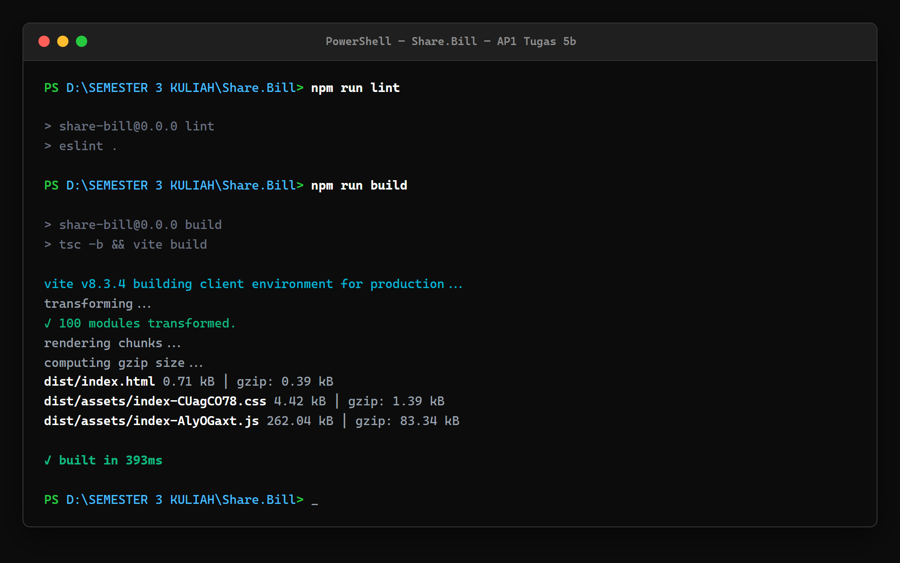

# Laporan Audit Performa AP1 Tugas 5c — Performance Report
## Proyek: Share.Bill

---

### Informasi Proyek & Identitas Kelompok

- **Mata Kuliah:** Application Project 1 (AP1) — Tugas 5c
- **Kelompok:** QWERTY
- **Nama Proyek:** Share.Bill
- **Jenis Aplikasi:** Aplikasi pembagian tagihan berdasarkan pesanan masing-masing orang (*split bill*)
- **Tautan Repository GitHub:** [https://github.com/Jibril061/Share.Bill](https://github.com/Jibril061/Share.Bill)
- **Anggota Kelompok:**
  1. Mukhamad Jibril Hidayatullah
  2. Daffa Muhamad Ramadhan
  3. Marchel Yohannes Sihombing

---

## 1. Pendahuluan dan Tujuan Audit

Audit performa ini dilakukan untuk mengevaluasi secara kuantitatif dampak teknis dari implementasi **PWA (Tugas 5a)** dan **Reusable Components (Tugas 5b)** terhadap kecepatan muat (*loading speed*), efisiensi sumber daya (*bundle size*), aksesibilitas, kepatuhan praktik terbaik (*best practices*), serta optimasi mesin pencari (*SEO*).

Pengujian membandingkan data aktual pada kondisi awal (*Baseline* sebelum pengerjaan Tugas 5) dengan kondisi aplikasi saat ini setelah seluruh kode PWA dan komponen antarmuka diterapkan pada repositori `main`.

---

## 2. Metodologi dan Kondisi Lingkungan Pengujian

Pengujian kedua fase dilakukan secara terkontrol menggunakan konfigurasi audit yang sebanding:

- **Perintah Build:** `npm run build` (`tsc -b && vite build`) — selesai dalam waktu 545 ms.
- **Server Pengujian:** `npm run preview` (`vite preview`) pada URL target `http://localhost:4173/`.
- **Alat Audit:** Google Lighthouse CLI versi `13.5.0` (didukung engine aksesibilitas `axe-core 4.14.0`).
- **Mesin Browser:** Google Chrome Headless versi `155.0.0.0` pada sistem operasi 64-bit Windows.
- **Profil Emulasi:** Mobile (Moto G Power 2022, viewport 412 × 823 piksel, DPR 1.75).
- **Metode Throttling:** Simulasi standar Lighthouse (*Simulated / Lantern Throttling*):
  - Latensi RTT: 150 ms
  - Bandwidth Unduh: 1.638,4 Kbps (~1,6 Mbps)
  - Pelambatan CPU: 4× *CPU slowdown multiplier*
- **Waktu Eksekusi Audit:**
  - *Baseline:* 18 Oktober 2026, 23:17 WIB (`2026-10-18T16:17:23.455Z`)
  - *Post-Tugas 5 (5a + 5b):* 19 Oktober 2026, 00:44 WIB (`2026-10-18T17:44:27.250Z`)

### Catatan Komparabilitas Konfigurasi & Keterbatasan Pengujian
1. **Kesetaraan Konfigurasi:** Pemeriksaan menyeluruh terhadap objek `configSettings` pada kedua berkas JSON membuktikan kesetaraan konfigurasi 100% (opsi emulasi layar, throttling jaringan, kategori audit, dan `clearStorageTypes` identik).
2. **Kondisi Cache & Service Worker:** Sesuai setelan baku Lighthouse (`clearStorageTypes: ["service_workers", "cache_storage", ...]`), cache browser dibersihkan sebelum pengujian. Dengan demikian, audit ini mengukur kondisi **first-load** (kunjungan pertama kali pengguna). Pengujian ini **tidak mengukur secara langsung** manfaat caching Service Worker pada kunjungan ulang (*repeat visit*) maupun kesiapan fallback saat koneksi terputus total (*offline mode*).
3. **Variasi Benchmark CPU Host:** Nilai indeks benchmark mesin lokal terukur sebesar **1589** pada baseline dan **1471** pada pengujian terkini (selisih ~7,4% akibat variasi beban latar belakang sistem operasi Windows). Karena model simulasi Lantern mengalikan trace waktu berdasarkan benchmark komputasi, fluktuasi ini dapat memengaruhi perhitungan estimasi metrik waktu dalam kisaran puluhan milidetik.

---

## 3. Hasil Pengujian dan Perbandingan Head-to-Head

### A. Skor Kategori Lighthouse (Skala 0 – 100)

| Kategori Audit | Skor Baseline | Skor Terkini (Post 5a + 5b) | Selisih (Delta) | Status Evaluasi |
| :--- | :---: | :---: | :---: | :--- |
| **Performance** | **100** *(raw: 1.0)* | **99** *(raw: 0.99)* | -1 poin | **Puncak (Zona Hijau)** — Performa tetap optimal |
| **Accessibility** | **94** *(raw: 0.94)* | **94** *(raw: 0.94)* | 0 (Tetap) | **Sangat Baik** — Menjaga standar kepatuhan a11y |
| **Best Practices** | **100** *(raw: 1.0)* | **100** *(raw: 1.0)* | 0 (Tetap) | **Sempurna (100%)** — Tanpa isu keamanan/praktik web |
| **SEO** | **82** *(raw: 0.82)* | **91** *(raw: 0.91)* | **+9 poin** | **Peningkatan Signifikan** — Metadata PWA lolos audit |

---

### B. Core Web Vitals & Metrik Pemuatan Kunci

| Metrik Kunci | Nilai Baseline *(Tampilan \| Riil)* | Nilai Terkini *(Tampilan \| Riil)* | Selisih Riil *(Delta)* | Standar Kelayakan Google |
| :--- | :---: | :---: | :---: | :--- |
| **First Contentful Paint (FCP)** | 1,4 detik *(1.374,1 ms)* | **1,5 detik** *(1.453,2 ms)* | +79,1 ms | Baik (*Good* ≤ 1,8 detik) |
| **Largest Contentful Paint (LCP)** | 1,4 detik *(1.374,1 ms)* | **1,6 detik** *(1.603,2 ms)* | +229,1 ms | Baik (*Good* ≤ 2,5 detik) |
| **Total Blocking Time (TBT)** | 10 ms *(7,0 ms)* | **50 ms** *(54,5 ms)* | +47,5 ms *(riil)* | Baik (*Good* ≤ 200 ms) |
| **Cumulative Layout Shift (CLS)** | **0** *(0,000)* | **0** *(0,000)* | 0,000 | Sempurna (*Good* ≤ 0,1) |
| **Speed Index (SI)** | 1,4 detik *(1.374,1 ms)* | **1,5 detik** *(1.453,2 ms)* | +79,1 ms | Baik (*Good* ≤ 3,4 detik) |
| **Time to Interactive (TTI)** | 1,4 detik *(1.409,3 ms)* | **1,8 detik** *(1.760,6 ms)* | +351,3 ms | Baik (*Good* ≤ 3,8 detik) |

*Catatan Khusus TBT:*
Lighthouse secara default membulatkan angka tampilan TBT ke kelipatan 10 ms terdekat (7,0 ms dibulatkan menjadi 10 ms; 54,5 ms dibulatkan menjadi 50 ms). Oleh karena itu, selisih angka tampilan tampak sebesar 40 ms (50 ms - 10 ms), sedangkan selisih nilai kalkulasi riil tanpa pembulatan adalah **+47,5 ms** (54,5 ms - 7,0 ms). Kedua nilai disajikan secara transparan agar tidak menimbulkan salah tafsir.

---

### C. Verifikasi Ukuran Berkas Bundel (*Bundle Size*)

Pengukuran dipisahkan secara tegas antara ukuran berkas fisik hasil kompilasi dan ukuran transfer protokol jaringan HTTP:

#### 1. Ukuran Berkas Hasil Build Produksi (`dist/`)
Mengukur ukuran fisik berkas (*raw resource size*) dan ukuran setelah kompresi fisik mandiri pada direktori build:

| Berkas Aset | Ukuran Raw Baseline | Ukuran Raw Terkini | Selisih Raw | Ukuran Gzip Terkini (Metode Pengukuran) |
| :--- | :---: | :---: | :---: | :--- |
| **JavaScript (`dist/assets/*.js`)** | 259,46 kB *(259.455 B)* | **262,04 kB** *(262.041 B)* | +2,59 kB *(+2.586 B)* | **82,49 kB** *(kompresi mandiri zlib)*<br>**83,34 kB** *(pelaporan build Vite)* |
| **CSS (`dist/assets/*.css`)** | 1,65 kB *(1.652 B)* | **4,42 kB** *(4.420 B)* | +2,77 kB *(+2.768 B)* | **1,38 kB** *(kompresi mandiri zlib)*<br>**1,39 kB** *(pelaporan build Vite)* |
| **HTML (`dist/index.html`)** | 0,46 kB *(460 B)* | **0,72 kB** *(712 B)* | +0,26 kB *(+252 B)* | **0,39 kB** *(kompresi mandiri zlib & Vite)* |
| **Total Bundel JS + CSS** | **261,11 kB** *(261.107 B)* | **266,46 kB** *(266.461 B)* | **+5,35 kB (+2,05%)** | **83,88 kB** *(kompresi mandiri zlib)*<br>**84,73 kB** *(pelaporan build Vite)* |

*Penjelasan Metode Pengukuran Gzip Terkini:*
- **Kompresi Mandiri Node.js zlib (`zlib.gzipSync`):** Ukuran kompresi gzip riil yang dihitung langsung terhadap berkas fisik di disk `dist/assets/`, menghasilkan **82,49 kB** untuk JS dan **1,38 kB** untuk CSS (total **83,88 kB**).
- **Pelaporan CLI Build Vite:** Ukuran estimasi kompresi yang dilaporkan langsung pada konsol terminal Vite saat build selesai, mencatat **83,34 kB** untuk JS dan **1,39 kB** untuk CSS (total **84,73 kB**).
- Selisih kecil (~850 byte) di antara kedua angka tersebut disebabkan oleh perbedaan setelan level kompresi utilitas Vite terhadap kompresi mandiri file fisik, bukan karena data baru. Selisih gzip terhadap baseline tidak dihitung karena data gzip baseline yang tersedia merupakan estimasi yang tidak diukur secara sebanding.

#### 2. Ukuran Transfer Jaringan Protokol HTTP (Audit Lighthouse `network-requests`)
Mengukur jumlah byte riil yang ditransfer melalui jaringan (*wire transfer size*) pada kedua sesi audit:

| Permintaan Sumber Daya | Transfer Baseline | Transfer Terkini | Selisih Transfer HTTP | Keterangan Protokol & Header |
| :--- | :---: | :---: | :---: | :--- |
| **Root Document (`http://localhost:4173/`)** | 710 B | 966 B | +256 B | Body HTML mentah (460 B → 716 B) + Header HTTP (~250 B). Server preview lokal tidak meng-gzip dokumen HTML. |
| **Bundel JavaScript (`*.js`)** | 81.959 B *(81,96 kB)* | 82.921 B *(82,92 kB)* | +962 B *(+0,96 kB)* | Payload JS terkompresi gzip + Header respons HTTP. |
| **Stylesheet CSS (`*.css`)** | 1.072 B *(1,07 kB)* | 1.747 B *(1,75 kB)* | +675 B *(+0,68 kB)* | Payload CSS terkompresi gzip + Header respons HTTP. |
| **Total Transfer JS + CSS** | **83.031 B (83,03 kB)** | **84.668 B (84,67 kB)** | **+1.637 B (+1,64 kB)** | Kenaikan transfer wire bersih protokol HTTP sebesar +1,97%. |

*Penjelasan Khusus Ukuran HTML:*
Ukuran transfer HTML pada log jaringan (710 B pada baseline dan 966 B pada post-5b) tampak lebih besar dari ukuran berkas mentahnya (460 B dan 716 B). Hal ini bukan karena kompresi gagal, melainkan karena server preview lokal mengirim dokumen HTML tanpa kompresi gzip sehingga ukuran transfer mencerminkan penjumlahan ukuran body HTML mentah ditambah ukuran header respons HTTP (~250 byte). Pada kompresi fisik mandiri (Vite), berkas HTML menciut menjadi **0,39 kB (393 byte)**.

---

## 4. Bukti Eksekusi Terminal Aktual

Tangkapan layar terminal autentik saat proses kompilasi bundel produksi (`npm run build`) dijalankan pada mesin pengembang lokal:


*Gambar 1. Bukti eksekusi terminal PowerShell menampilkan hasil build produksi Vite dan verifikasi ukuran aset dist/.*

---

## 5. Analisis Kritis Berbasis Bukti Audit

### 1. Peningkatan Signifikan Skor SEO (+9 Poin: 82 → 91)
- **Fakta Audit Baseline:** Audit `meta-description` berstatus gagal (*score: 0*, *"Document does not have a meta description"*).
- **Fakta Audit Terkini:** Audit `meta-description` berstatus lulus (*score: 1*). Peningkatan ini terbukti secara langsung dihasilkan oleh penambahan elemen `<meta name="description" content="Share.Bill - Split bills based on what everyone ordered." />` pada `index.html` pada Tugas 5a.
- **Sebab Belum 100:** Audit `robots-txt` bernilai 0 (*"robots.txt is not valid"*). Hal ini disebabkan karena berkas `robots.txt` belum disediakan di direktori `public/`. Server SPA Vite preview mengembalikan dokumen fallback `index.html` saat Lighthouse meminta `/robots.txt`, sehingga parser validator mendeteksi format HTML sebagai sintaks robots.txt yang tidak valid.

### 2. Evaluasi Metrik Waktu & Total Blocking Time (TBT)
Dalam mengevaluasi perubahan skor Performance dari 100 ke 99 serta pergeseran TBT dari 7,0 ms (tampilan 10 ms) ke 54,5 ms (tampilan 50 ms), penting untuk membedakan antara fakta hasil observasi audit dengan hipotesis teknis penyebabnya:

#### A. Fakta Hasil Pengamatan Audit (*Audit Observations*):
1. TBT terukur mengalami pergeseran dari 7,0 ms ke 54,5 ms, namun tetap berada dalam kategori aman menurut acuan Google (di bawah ambang batas 200 ms).
2. Data rincian kerja thread utama (*mainthread-work-breakdown*) mencatat kenaikan durasi pada kategori `scriptEvaluation` (+105,8 ms, dari 90,4 ms ke 196,2 ms) dan `styleLayout` (+21,1 ms, dari 140,1 ms ke 161,2 ms).
3. Nilai indeks benchmark komputasi mesin lokal tercatat berbeda antara kedua pengujian (1589 pada baseline vs 1471 pada pengujian terkini, selisih ~7,4%).
4. Log audit jaringan menunjukkan tidak ada proses eksekusi thread `sw.js` selama audit navigasi karena seluruh storage dan service worker dibersihkan sebelum pengujian oleh setelan `clearStorageTypes`.

#### B. Dugaan / Hipotesis Teknis yang Masuk Akal (*Technical Hypotheses*):
1. Kenaikan waktu pada `scriptEvaluation` dan `styleLayout` menjadi indikasi yang ditemukan pada audit mengenai potensi beban komputasi tambahan. Namun, temuan ini **tidak dapat dinyatakan sebagai bukti mutlak bahwa komponen Button, Card, atau CSS merupakan penyebab tunggal**, mengingat adanya interaksi dinamis modul lain serta perbedaan lingkungan eksekusi.
2. Fluktuasi daya komputasi mesin lokal (tercermin dari indeks benchmark yang ~7,4% lebih rendah) berpotensi memengaruhi algoritma simulasi pelambatan CPU (Lantern) dalam memproyeksikan metrik waktu ke perangkat mobile.
3. Kenaikan TBT tidak dapat disimpulkan sebagai akibat dari Service Worker, karena tidak ditemukan jejak aktivitas Service Worker pada trace kerja thread utama selama audit berlangsung.

### 3. Kestabilan Layout Shift (CLS = 0)
- Nilai CLS tetap **0,000** tanpa deviasi. Bukti ini memverifikasi bahwa komponen antarmuka baru (`Card` dan `FormField`) memiliki deklarasi ukuran visual dan padding yang kokoh, sehingga tidak menimbulkan pergeseran tata letak dinamis (*visual jerk*) saat elemen dirender ke layar pada skenario pengujian ini.

### 4. Analisis Aksesibilitas (Skor 94 Tetap Konsisten)
- Skor Accessibility secara keseluruhan berada pada angka **94** (skala 100), stabil sama persis dengan kondisi baseline awal.
- Berdasarkan laporan audit otomatis Lighthouse (axe-core) pada halaman Beranda, skor Accessibility tertahan di 94 bukan karena isu struktur semantik baru, melainkan karena masih adanya temuan rasio kontras warna (*color-contrast*, *score: 0*):
  - Tautan aktif navigasi: `<a class="nav-link active">Home</a>` (rasio kontras terukur 3.76:1).
  - Tombol aksi utama: `<button class="btn btn-primary">Buat Tagihan</button>` (rasio kontras terukur 3.76:1).
  - Standar WCAG AA merekomendasikan rasio kontras minimal **4.5:1** untuk teks ukuran normal (14px). Karena warna hijau emerald `#059669` dipertahankan untuk konsistensi identitas visual aplikasi, temuan kontras ini tetap tercatat pada hasil audit.

### 5. Kepatuhan Praktik Terbaik / Best Practices (100% Sempurna)
- Seluruh 16 kriteria audit Best Practices berstatus lulus tanpa peringatan (*Issues* panel di DevTools bersih, doctype valid, charset UTF-8 tepat, tidak ada library JavaScript rentan).

---

## 6. Ringkasan Evaluasi Dampak Teknis

| Aspek Pengujian | Dampak yang Teramati | Beban Sumber Daya (*Overhead*) | Catatan Evaluasi Lingkup Uji |
| :--- | :--- | :--- | :--- |
| **PWA (Tugas 5a)** | PWA installable, kelengkapan metadata web app, SEO meningkat +9 poin. | Metadata HTML bertambah 256 byte. | Pengujian first-load memvalidasi metadata & manifest, namun **belum mengukur langsung** performa caching repeat-visit atau offline fallback. |
| **Reusable Components (Tugas 5b)** | Standarisasi antarmuka, aksesibilitas terstruktur, konsistensi form. | Bundel JS+CSS bertambah +5,35 kB raw (+1,64 kB transfer HTTP); TBT 50 ms. | Pertambahan ukuran terkendali pada skenario pengujian yang dilakukan. |

---

## 7. Keterbatasan Metodologi Pengujian

1. **Skenario First-Load Saja:** Pengujian otomatis Lighthouse secara default menghapus cache dan mematikan Service Worker aktif untuk mengevaluasi kondisi pengguna baru pertama kali. Pengujian ini tidak mencerminkan secara langsung kecepatan pembacaan cache Service Worker pada kunjungan ulang (*repeat visit*) maupun kesiapan fallback saat koneksi terputus total (*offline mode*).
2. **Variasi Lingkungan Mesin Lokal:** Pengukuran dijalankan pada lingkungan mesin pengembang lokal (laptop Windows) dengan fluktuasi benchmark CPU (1589 vs 1471). Pengujian di lingkungan Continuous Integration (CI) berbasis cloud akan memberikan angka yang lebih konstan.

---

## 8. Rekomendasi Teknis Lanjutan (Opsional untuk Iterasi Berikutnya)

1. **Penyempurnaan SEO Menuju 100:**
   Menambahkan berkas statis `public/robots.txt`:
   ```txt
   User-agent: *
   Allow: /
   ```
2. **Penyempurnaan Aksesibilitas Menuju 100:**
   Mengatur variasi warna primer teks menjadi `#047857` (Deep Emerald, rasio kontras > 4.5:1 terhadap putih) untuk memenuhi rekomendasi kontras WCAG AA tanpa mengubah nuansa hijau Share.Bill.

---

## 9. Kesimpulan Akhir

Berdasarkan audit performa komparatif antara kondisi baseline awal dan kondisi terkini setelah pengerjaan Tugas 5a (PWA) dan Tugas 5b (Reusable Components) pada proyek **Share.Bill** oleh Kelompok **QWERTY**, dapat disimpulkan bahwa:

1. **Kinerja Aplikasi Berada pada Tingkat yang Stabil:** Skor Performance tercatat pada level **99** dengan seluruh metrik Core Web Vitals (FCP 1,5 detik, LCP 1,6 detik, TBT 50 ms, CLS 0) berada di dalam ambang batas yang direkomendasikan Google pada skenario first-load yang diuji.
2. **Pertambahan Ukuran Berkas Terkendali:** Penambahan tiga komponen antarmuka modular beserta stylesheet menghasilkan pertambahan ukuran transfer HTTP JS+CSS sebesar **+1,64 kB** (+1,97%) dan pertambahan ukuran raw sebesar **+5,35 kB** (+2,05%).
3. **Peningkatan SEO Terkonfirmasi:** Penambahan metadata deskripsi PWA secara terukur meningkatkan skor SEO sebesar **+9 poin** (dari 82 menjadi 91).
4. **Stabilitas Tata Letak Terjaga:** Cumulative Layout Shift bernilai **0** membuktikan tidak adanya pergeseran tata letak visual saat elemen dimuat pada sesi pengujian ini.
5. **Cakupan Pengujian Terbatas:** Perlu dicatat bahwa evaluasi ini berfokus pada kondisi kunjungan awal (*first-load*) dan belum mengukur dampak efisiensi caching Service Worker saat kunjungan ulang maupun kondisi tanpa jaringan (*offline*).

Dengan demikian, data pengujian yang diperoleh menunjukkan bahwa implementasi Tugas 5a dan Tugas 5b dapat diintegrasikan dengan penambahan beban sumber daya yang terkelola dengan baik dalam batasan pengujian yang telah dilakukan.
